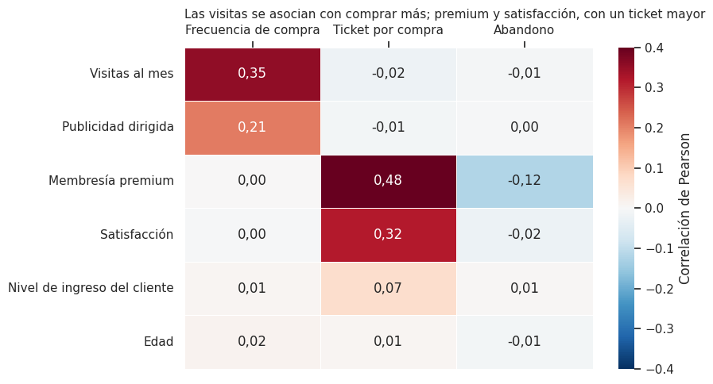
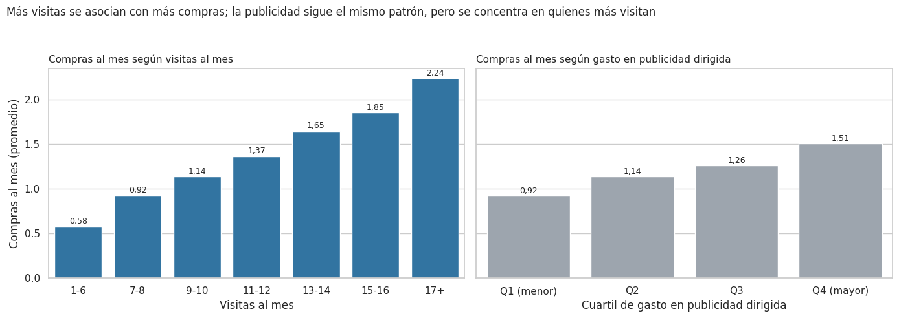
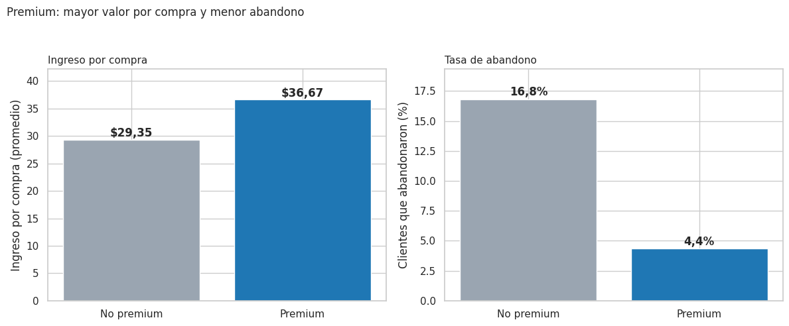

# 🛒 NovaRetail+: ¿qué factores del comportamiento del cliente se asocian con el ingreso anual?

Análisis correlacional de **15.000 clientes de NovaRetail+**, una plataforma de comercio electrónico en Latinoamérica, para el equipo de **Crecimiento y Retención**. Combina correlaciones de Pearson y Spearman, punto biserial y V de Cramér, y termina en un reporte ejecutivo con hallazgos, recomendaciones y limitaciones.

> **Correlación ≠ causalidad.** Es un análisis exploratorio: describe asociaciones y propone dónde probar con experimentos, no demuestra efectos.

## 🎯 Pregunta de negocio
¿Qué factores del comportamiento del cliente están más fuertemente asociados con el ingreso anual generado?

## 🛠️ Stack técnico
Python · pandas · NumPy · SciPy · seaborn · matplotlib · Jupyter Notebook

## 📁 Estructura del repositorio
```
├── notebook/
│   └── analisis_novaretail.ipynb     # Análisis completo y reporte ejecutivo
├── data/
│   └── novaretail_comportamiento_clientes_2024.csv
├── images/                           # Gráficos usados en este README
└── README.md
```
El notebook lee los datos con una ruta relativa (`../data/...`) y se puede ejecutar de principio a fin al clonar el repositorio.

## 🗃️ Datos
15.000 clientes, sin duplicados ni valores nulos. Datos de práctica del bootcamp de TripleTen.

| Columna | Descripción |
|---|---|
| `id_cliente` | Identificador único |
| `edad`, `nivel_ingreso` | Edad (18 a 75 años) e ingreso anual estimado del cliente |
| `visitas_mes`, `compras_mes` | Visitas y compras al mes |
| `gasto_publicidad_dirigida` | Gasto en anuncios asignado al cliente |
| `satisfaccion` | Calificación de 1 a 5 |
| `miembro_premium`, `abandono` | Indicadores 0/1 |
| `tipo_dispositivo`, `region` | Móvil, escritorio o tablet; norte, sur, este u oeste |
| `ingreso_anual` | **Variable foco:** ingreso anual que genera el cliente (la moneda no se especifica; se muestra con "$") |

## 🔎 Metodología
1. **Exploración y calidad de datos:** tipos, rangos, duplicados y nulos.
2. **Visualización:** heatmap de correlaciones y scatterplots de los pares clave.
3. **Coeficientes según el tipo de variable:** Pearson y Spearman (numéricas), punto biserial (numérica–binaria) y V de Cramér (categóricas).
4. **Verificación de relaciones sospechosas:** se comprobó por qué el ingreso correlaciona 0,97 con las compras.
5. **Interpretación para el negocio:** cada hallazgo con evidencia visual, evidencia numérica, interpretación no causal, lo que no se puede afirmar y su implicación.

## 📈 Key Findings



El ingreso de un cliente es, en la práctica, **cuántas veces compra × cuánto vale cada compra**, y cada palanca se asocia con factores distintos:

| Palanca | Factores asociados | Factores sin relación |
|---|---|---|
| **Frecuencia de compra** | Visitas al mes (0,35) y publicidad dirigida (0,21, entrelazada con las visitas) | Premium, satisfacción, edad, nivel de ingreso |
| **Ticket por compra** | Membresía premium (0,48; +25% por compra) y satisfacción (0,32) | Visitas, publicidad |
| **Retención** | Membresía premium (abandono de 4,4% frente a 16,8%) | Dispositivo, región, visitas, compras, ingreso |

### 1. Casi un tercio de los clientes no compra, y sin compras no hay ingreso
Los 4.567 clientes sin compras (30,4%) tienen ingreso anual de exactamente 0. Entre quienes compran, el ingreso por compra es casi constante ($30,38; desviación $5,34), por lo que la correlación de 0,97 entre compras e ingreso es en gran parte **por construcción**.
- **Implicación:** el mayor margen de crecimiento está en activar a los clientes sin compras; cada compra mensual adicional equivale a unos $30 de ingreso anual por cliente.

### 2. Las visitas se asocian con comprar más; la publicidad, solo a través de ellas
Las compras promedio suben de 0,58 (6 visitas o menos) a 2,24 (más de 16). La publicidad correlaciona 0,21 con las compras, pero al controlar las visitas cae a 0,004: publicidad y visitas están entrelazadas (0,58).



- **Implicación:** trabajar el engagement como indicador adelantado de compra y **medir la incrementalidad de la publicidad** con un grupo de control antes de ajustar la inversión.

### 3. Los clientes premium gastan 25% más por compra y abandonan casi cuatro veces menos
Ticket de $36,67 frente a $29,35; abandono de 4,4% frente a 16,8% (V de Cramér 0,120; p < 0,001). Compran con la misma frecuencia que los no premium. Son el 13,9% de los clientes y generan el 17,0% del ingreso.



- **Implicación:** premium es una palanca de ticket y retención. Conviene probar con un experimento si aumentar su penetración produce estos beneficios.

### 4. La satisfacción se asocia con un ticket mayor, no con más compras
El ticket pasa de $28,06 (satisfacción de 2 a 3) a $32,33 (4 a 5), tanto en premium como en no premium; las compras al mes se mantienen planas (correlación -0,004).

### 5. Edad, nivel de ingreso, dispositivo y región no distinguen a los clientes de mayor valor
Correlaciones de ~0,02 con el ingreso; ingreso medio entre $36,42 y $37,07 según dispositivo (p = 0,499) y entre $35,72 y $37,10 según región (p = 0,448). El abandono no depende del dispositivo (V = 0,007) ni de la región (V = 0,015).
- **Implicación:** segmentar por comportamiento (visitas, compras, membresía) más que por atributos demográficos o de dispositivo.

## 💡 Recomendaciones

| Prioridad | Acción | Cómo validarlo |
|---|---|---|
| 1 | Activar a los clientes sin compras (30,4%) | Campañas de primera compra con grupo de control |
| 2 | Impulsar las visitas y medir la incrementalidad de la publicidad dirigida | Prueba con grupo sin anuncios |
| 3 | Aumentar la penetración de premium (hoy 13,9%) | Oferta de prueba a una muestra aleatoria |
| 4 | Usar la satisfacción como indicador de valor por compra | Seguimiento por segmento |
| 5 | Dejar de segmentar por edad, nivel de ingreso, dispositivo o región | Probar modelos con varias variables a la vez |

## ⚠️ Limitaciones
- **Asociación no es causalidad:** son correlaciones en datos observacionales.
- **El ingreso depende de las compras casi por construcción.** El ticket por compra es un indicador derivado (`ingreso_anual ÷ compras_mes`) y se usa como medida relativa, porque no se conoce la escala exacta de ambas variables.
- **Análisis de a pares:** no se modelan efectos conjuntos; publicidad y visitas no se pueden separar por completo.
- **Sin dimensión temporal:** no se sabe cuándo abandonaron los clientes.
- **Autoselección en premium:** quienes contratan premium pueden diferir de los demás desde el inicio.
- **Grupos pequeños:** premium (13,9%), tablet (9,7%) y los clientes con satisfacción de 1 a 2 (90) se interpretan con cautela.
